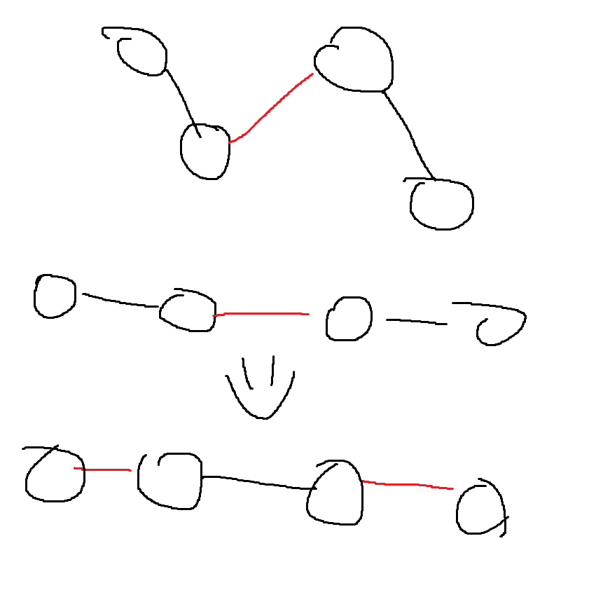

匈牙利算法 本质是基于二分图增广路的算法

增广路在二分图中的定义是

1.首尾边是非匹配边
2.匹配边和首尾边交替出现
3.此时交换匹配边和首尾边 匹配边就会+1 
如下图

所以要求二分图最大匹配
只需要对每个点不断的求增广路即可 
单次的时间复杂度为o(n + m) 找的次数为min(两边点数) 假设点分布均匀 则最差为o(n(n + m)) 

寻找的过程可以用dfs来不断寻找递归
只需要维护
1.g[u] 左节点能连接的节点
2.match_r, 当前右节点匹配的左节点
3.timer 计算当前轮次
3.vis数组 在循环中作为当前轮次的判断

板子
#include <bits/stdc++.h>
using namespace std;
using i64 = long long;
#define endl '\n'

i64 n, m, e, timer = 0;
vector<vector<i64>> g;
vector<i64> match_r;
vector<i64> vis;

bool dfs(i64 u) {
	for(auto &v:g[u]) {
		if(vis[v] == timer) continue;
		vis[v] = timer;
		if(match_r[v] == -1 || dfs(match_r[v])) {
			match_r[v] = u;
			return 1;
		}
	}
	return 0;
}

int main() {

	cin >> n >> m >> e;
	g.resize(n + 1);
	match_r.assign(m + 1, -1);
	vis.assign(m + 1, 0);

	for(int i = 1; i <= e; i++) {
		i64 u, v;
		cin >> u >> v;
		g[u].push_back(v);
	}

	i64 ans = 0;
	for(i64 i = 1; i <= n; i++) {
		timer++;
		if(dfs(i)) ans++;
	}
	cout << ans << endl;
}

